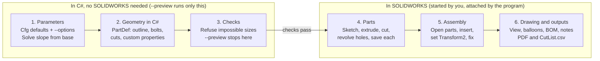

# CAD as Code with C# and SOLIDWORKS

Last updated 8 November 2026 · tnbozman

## What CAD as code means here

You describe the design once in C# and let SOLIDWORKS draw it. Change one number, run the program, and every part, the assembly, the drawing and the cut list come out consistent.

The working example is `TreeBuilder.cs` from the PineTree project: a flat, bolt-together Christmas tree in pine. One run produces:

- 10 part files (`.SLDPRT`): six uprights, the rail, the foot, and the two printed star pieces
- `PineTree.SLDASM`, with every part in place
- `PineTree.SLDDRW` and `PineTree.PDF`: an A3 build sheet with a front view, balloons, a parts table (length, end cuts, hole positions) and a close-up of the star
- `CutList.csv`: the same table for a spreadsheet

The C# side owns the design: all geometry, derived angles, hole positions and sanity checks. SOLIDWORKS is treated as a renderer and file writer. That split is what makes the model easy to change and the numbers trustworthy.

## Setup

A .NET Framework 4.8 x64 console app that references two SOLIDWORKS interop DLLs is all you need. Build it with `dotnet build -c Release`.

| Item | Value | Why |
| --- | --- | --- |
| Target framework | `net48` | The interop assemblies are .NET Framework COM wrappers |
| Platform | `x64` | SOLIDWORKS is 64-bit; an AnyCPU or x86 process can't talk to it reliably |
| References | `SolidWorks.Interop.sldworks.dll`, `SolidWorks.Interop.swconst.dll` | The API objects and the enum constants |
| Reference location | `<install>\SOLIDWORKS\api\redist` | Set once as an MSBuild property (`SWAPI`) so another PC can override it |
| `EmbedInteropTypes` | `False` | Keeps the full typed API and enums |
| Entry point | `[STAThread] static int Main` | COM calls into SOLIDWORKS expect a single-threaded apartment |

The project file reference looks like this:

```xml
<SWAPI Condition="'$(SWAPI)' == ''">C:\Program Files\Dassault Systemes\SOLIDWORKS 3DEXPERIENCE R2026x\SOLIDWORKS\api\redist</SWAPI>
...
<Reference Include="SolidWorks.Interop.sldworks">
  <HintPath>$(SWAPI)\SolidWorks.Interop.sldworks.dll</HintPath>
  <EmbedInteropTypes>False</EmbedInteropTypes>
</Reference>
```

The run workflow:

1. Start SOLIDWORKS yourself (from the 3DEXPERIENCE launcher, logged in) and wait until it has finished loading.
2. Run the exe from a terminal at the same elevation as SOLIDWORKS: both normal, or both "Run as administrator".
3. The program attaches to the running SOLIDWORKS and never starts its own.

## Architecture

The program is a one-way pipeline: parameters become plain C# geometry, the geometry is checked, and only then is SOLIDWORKS asked to build anything.



Steps 1 to 3 run without SOLIDWORKS, so any size can be checked with `--preview` in a second. Steps 4 to 6 drive SOLIDWORKS in order, and every number they write comes from step 2.

## Core API patterns

Every part follows the same recipe: sketch an outline on the Front plane, extrude it symmetrically, then cut holes and notches. The API works in metres, so keep the design in millimetres and multiply by `MM = 0.001` at the call.

### Connect to a running SOLIDWORKS

```csharp
var app = (SldWorks)Marshal.GetActiveObject("SldWorks.Application");   // retry in a loop until it appears
while (!app.StartupProcessCompleted) Thread.Sleep(1000);
app.Visible = true;
```

### Make settings safe for automation

Turn these off before drawing and restore them in a `finally`:

```csharp
var toggles = new[] {
    swUserPreferenceToggle_e.swInputDimValOnCreate,      // no "enter dimension" pop-ups
    swUserPreferenceToggle_e.swSketchInference,          // no snapping
    swUserPreferenceToggle_e.swSketchAutomaticRelations, // no auto relations
    swUserPreferenceToggle_e.swAutoNormalToSketchMode }; // no view rotation per sketch
app.CommandInProgress = true;                            // fewer UI updates
```

Per part, write sketch entities straight to the database and stop redraws:

```csharp
m.SketchManager.AddToDB = true;
m.SketchManager.DisplayWhenAdded = false;
((ModelView)m.ActiveView).EnableGraphicsUpdate = false;
```

### Sketch, extrude, cut

```csharp
m.Extension.SelectByID2("Front Plane", "PLANE", 0, 0, 0, false, 0, null, 0);
m.SketchManager.InsertSketch(true);
string name = ((Feature)m.SketchManager.ActiveSketch).Name;   // remember it
foreach (edge) m.SketchManager.CreateLine(x1*MM, y1*MM, 0, x2*MM, y2*MM, 0);
m.SketchManager.InsertSketch(true);                            // close
m.Extension.SelectByID2(name, "SKETCH", 0, 0, 0, false, 0, null, 0);
m.FeatureManager.FeatureExtrusion2(true, false, false,
    (int)swEndConditions_e.swEndCondMidPlane, 0, depth*MM, 0, ...);
```

A through-cut is the same sketch followed by `FeatureCut4` with `swEndCondMidPlane` and a depth larger than the part.

### Round holes at any angle in the plane

Sketch a centre line along the bolt axis and a thin rectangle (bolt radius wide) on one side of it, then `FeatureRevolve2` with the cut flag set, 360 degrees. Because the profile is on the Front plane, the hole can point in any in-plane direction without creating extra reference planes.

### Custom properties and saving

```csharp
var cpm = m.Extension.CustomPropertyManager[""];
cpm.Add3("Length", (int)swCustomInfoType_e.swCustomInfoText, "507.9",
         (int)swCustomPropertyAddOption_e.swCustomPropertyReplaceValue);

int err = 0, warn = 0;
if (!m.Extension.SaveAs3(path, 0, (int)swSaveAsOptions_e.swSaveAsOptions_Silent,
                         null, null, ref err, ref warn) || err != 0)
    throw new Exception($"Could not save {path} (error {err})");
```

### Assembly: model in place, then pin the transform

Model every part at its final position. Open the saved parts (`OpenDoc6`), insert each one with `AddComponent5`, then set its transform explicitly. `AddComponent5` places the part's bounding-box centre at the point you give, not its origin.

```csharp
var xf = (MathTransform)mu.CreateTransform(new double[] {
    1,0,0, 0,1,0, 0,0,1,   // rotation
    x*MM, 0, 0,            // translation
    1, 0,0,0 });           // scale, unused
comp.Transform2 = xf;
comp.Select4(false, null, false); asm.FixComponent();
```

### Drawing, BOM and PDF

- `CreateDrawViewFromModelView3(asmPath, "*Front", x, y, 0)`, then set `ScaleDecimal` and `Position`
- `AutoBalloon5` with options from `CreateAutoBalloonOptions()`
- `view.InsertBomTable4(...)` with `bom-standard.sldbomtbt` from `<install>\lang\english`
- Extra BOM columns: `InsertColumn2`, then `SetColumnCustomProperty(index, "Length")` and `SetColumnTitle2`
- Row heights: `SetRowHeight` on every row, otherwise rows stay tall after narrowing columns
- Notes: `InsertNote(text)`, then `SetPosition2` on its annotation
- Detail view: sketch a circle in the parent view's sketch coordinates (map sheet points through `((Sketch)view.GetSketch()).ModelToSketchTransform`), select it, `CreateDetailViewAt4`, then `ActivateSheet` to leave the view
- PDF: `Extension.SaveAs3("...PDF", ...)` on the drawing

## Parameters and validation

All inputs live in one `Cfg` class, every field can be overridden on the command line, and a `--preview` run checks a size without touching SOLIDWORKS.

```text
TreeBuilder.exe D:\out --height 1500 --base 750 --W 45 --T 90
TreeBuilder.exe --preview --height 1500 --base 750
```

- **One parser for every field.** `--Name value` is matched to a public `double` field by reflection (case-insensitive), plus friendly aliases such as `--height` and `--base`. A typo lists every valid option.
- **Ask for what people measure, derive the rest.** The user gives height and rail length; the upright slope is solved from them by bisection, so the saw angles follow automatically.
- **Sensible automatic defaults.** A value of 0 means "work it out" (for example, the top and bottom upright lengths scale with height, and the star neck thickness follows the timber thickness).
- **Refuse impossible designs before building.** Checks run on the derived geometry: laps that would meet, a top upright too short for the apex bolts, legs that would meet on the rail, slope over 30 degrees. Each prints a plain reason and exits with code 3.
- **Warn, don't refuse, on soft limits.** A board longer than the stock length (`--StockLen`) is a warning.
- **Print what you built.** Every run prints the parameters, the derived slope and the full cut list, so the terminal output is a record of the design.

## FAQ: what went wrong getting started

Most early failures were SOLIDWORKS going away mid-call or silently doing something other than asked. In order of when we hit them:

### Why did it fail with "The RPC server is unavailable" on the first sketch line?

**Symptom:** the part was created, then `CreateLine` threw `0x800706BA` and SOLIDWORKS vanished with no crash log.

**Cause:** the program started its own SOLIDWORKS over COM. With the 3DEXPERIENCE edition that copy has no platform login, and it quit a few seconds later.

**Fix:** never start SOLIDWORKS from code. Start it from the launcher, then attach with `GetActiveObject` and wait for `StartupProcessCompleted`.

### It still crashed on the first line after attaching. Why?

**Cause:** sketch snapping and live redraw, driven from another process, crashed SOLIDWORKS.

**Fix:** `SketchManager.AddToDB = true` and `DisplayWhenAdded = false`. After that, the outline and extrude worked.

### Then it crashed during the first bolt hole. What fixed that?

**Symptom:** `0x800706BE` ("remote procedure call failed") while walking the feature tree after the hole sketch.

**Fix:** turn off graphics updates on the view, auto-rotate to sketch (`swAutoNormalToSketchMode`), automatic relations and inference; set `CommandInProgress = true`; select each sketch by its name instead of iterating features. Every part then built.

### Why did the assembly fail with "Could not insert P3R"?

**Cause:** `AddComponent5` only inserts documents that are open, and each part was closed after saving.

**Fix:** `OpenDoc6` every saved part (silently) before creating the assembly.

### All the parts were there, but the assembly was a mess. Why?

**Cause:** `AddComponent5` puts the part's bounding-box centre at the given point, not its origin. Every part was piled around the origin.

**Fix:** insert anywhere, then set `Component2.Transform2` to an explicit transform (identity plus any X offset).

### Changing the height alone was refused. Why?

**Cause:** the top and bottom uprights were fixed at 470 mm, so a short tree made the laps on the middle upright collide.

**Fix:** default those lengths to 0 = "scale with height", and keep explicit overrides.

### The star cap didn't follow the size changes. Why?

**Cause:** its outline was pasted in as fixed coordinates from an earlier Python model.

**Fix:** build it from formulas (slot angle from the slope, position from the height) and make notches with `FeatureCut4` instead of precomputed polygon differences.

### Adding a `--preview` switch crashed with InvalidCastException. Why?

**Cause:** the reflection-based option printer cast every public field to `double`, and the new switch was a `bool`.

**Fix:** filter reflected fields by `FieldType == typeof(double)`.

### The BOM had no Description column, very tall rows, and the notes on top of it. Why?

**Cause:** the standard BOM template has no Description column; rows keep their height after columns are narrowed; the notes were placed at a fixed spot.

**Fix:** insert and bind a Description column, `SetRowHeight` on every row, and place the notes under the table using its computed size.

### The PDF showed the old design after a change. Why?

**Symptom:** the notes were new but the view and table were old. The part files on disk were an hour old.

**Cause:** `SaveAs3` (the old overload) was failing and its result was ignored. The files were locked because unsaved documents from earlier failed runs (`Draw3`, `Assem4`, `Part41`) still referenced the old parts, so SOLIDWORKS kept them loaded as hidden documents.

**Fix:** use `Extension.SaveAs3` and throw on any error code; before building, close documents in the output folder and test each file for a lock, stopping with a list of open windows if any remain; if a run fails, close every document that run created.

### Why "The object invoked has disconnected from its clients"?

**Cause:** the code asked a document for its title after closing it.

**Fix:** read the title and path first, then close.

### The detail view circle was tiny and in the wrong place. Why?

**Cause:** a drawing view's sketch has its own coordinate system, not sheet coordinates.

**Fix:** map the sheet point through `ModelToViewTransform`, then through the view sketch's `ModelToSketchTransform`, and size the radius the same way.

### After that, the drawing wouldn't close for the next run. Why?

**Cause:** the view was left active for sketching after the detail was created.

**Fix:** `ActivateSheet` and clear the selection after adding the detail.

### Smaller snags

- **`Environment` is ambiguous:** the interop has its own `Environment` type; write `System.Environment`.
- **PowerShell can't query SOLIDWORKS** (`TYPE_E_ELEMENTNOTFOUND` on late-bound calls): put diagnostics inside the C# program instead.
- **One `W` set both width and thickness:** split into `W` (in the plane) and `T` (front to back) before trying 90x45 timber.
- **"Up to date" builds:** check the exe timestamp is newer than the source after `dotnet build`.

## Checklist for the next project

Start with these in place and most of the FAQ above never happens.

- [ ] Attach to a running SOLIDWORKS; never launch it from code
- [ ] Turn off inference, auto relations, dimension pop-ups and auto-rotate; restore them in `finally`
- [ ] `AddToDB = true`, `DisplayWhenAdded = false`, graphics updates off while building a part
- [ ] Keep geometry in plain C# (outlines, holes, cuts) so it can be checked and printed without SOLIDWORKS
- [ ] Add a `--preview` mode from day one
- [ ] Model parts in their final position; place components with an explicit `Transform2`
- [ ] Check every save's return value and error code
- [ ] Close documents from the output folder before a run, test files for locks, and close what a failed run created
- [ ] Log each step ("sketch open", "bolt hole 2/4") so a crash points to the call
- [ ] Put manufacturing numbers in custom properties so the BOM, CSV and drawing all read the same values
- [ ] Look at the PDF after every change: SOLIDWORKS can succeed and still draw the wrong thing
